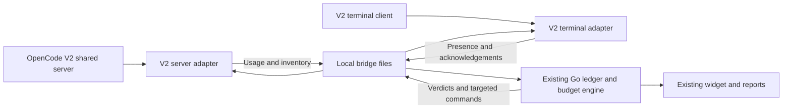

# OpenCode V2 edition

This edition branches from the V1 application and reuses its desktop UI, pricing,
ledger, reporting, persistence and budget engine. It has a separate V2 integration
and executable. The original V1 release remains available.

The initial validation target is **OpenCode 2.0.28 on Windows x64**. Later patches
require verification. The installer refuses an unknown CLI version or V1.
`OPENCODE_EXECUTABLE` can identify an exact binary when it is not available on PATH.

## Install the preview

1. Confirm OpenCode V2 is installed and close the V1 Odometer instance.
2. Run the executable labelled **OpenCodeV2** once.
3. Restart OpenCode to load its server and terminal integration.
4. Configure the desired session budget. New terminal instances start without limits.

Accounting history and private prices are retained in the normal Odometer data
directory. Do not run both editions against it simultaneously.

The preview is unsigned. If Windows blocks it, use **Properties → Unblock → Apply**.
If SmartScreen offers it, use **More info → Run anyway** after verifying its source
and checksum. On a managed computer, ask your administrator for approval rather
than disabling Windows security.

## Installed package and feature ownership

OpenCode 2.0.28 expects a directory for configured local plugin entries. The
installer creates this package in the user's OpenCode configuration directory:

```text
~/.config/opencode/plugins/odometer-v2/
  package.json
  index.js
  tui.tsx
  tui-presence.js
  v2-models.js
```

| Installed file | Repository source | Responsibility |
|---|---|---|
| `index.js` | [odometer-v2.js](../plugin/odometer-v2.js) | V2 hooks, usage events, model selection and automatic continuation. |
| `tui.tsx` | [odometer-v2-tui.tsx](../plugin/odometer-v2-tui.tsx) | Terminal identity, current conversation, routing label, early model inventory and cancellation. |
| `tui-presence.js` | [tui-presence.js](../plugin/tui-presence.js) | Heartbeats, closure and V2 widget startup. Shared helper, not a separate plugin. |
| `v2-models.js` | [v2-models.js](../plugin/v2-models.js) | Public model capabilities/prices in the existing picker format. Shared helper, not a separate plugin. |
| `package.json` | [installer](../internal/app/plugininstall.go) | Server and `./tui` exports. No npm installation is needed. |

The directory is registered under `plugins` in global `cli.json`. Server-side
local discovery finds it under `plugins/`. Unrelated settings and plugin entries
are preserved; only the old Odometer terminal-file registration is removed.
The previous `plugins/odometer.js` is backed up outside discovery as
`odometer-v1-<hash>.js.backup` before removal, avoiding duplicate active adapters.
The optional V1 diagnostic plugin is not included in this package.

The Go application continues to own budgets, prices, counters, reports, storage,
notifications, docking and tray controls. OpenCode owns tools, permissions,
provider credentials and agents.

## How it works



Terminal and server process identities are separate. Presence includes the
server PID and project location. The server publishes an inventory for each
owning terminal, preserving the app's command protocol while addressing the
correct V2 server and conversation.

The server uses `setup`, domain hooks and `event.subscribe`. It normalizes usage
into `events.jsonl`, backfills opened conversations and checks accounting
acknowledgements before additional budgeted steps. Catalog refreshes and backfills
are bounded rather than continuously fetching every conversation's entire history.

Transport uses OpenCode's authenticated plugin/terminal clients. The V2 widget
does not run the V1 HTTP/SSE reader against V2 routes or store server passwords in
its pointer. Remote-server control is not a tested capability of this local-file
edition. The terminal uses additive slots, leaving the native prompt, focus,
submission and Esc handling intact. A row represents one terminal instance and
its current root conversation, following the existing budget lifecycle.

## Budgets and continuation

The existing [budget behaviour](BUDGET_RULES.md) applies. After exhaustion, the
adapter blocks further paid steps, lets tools settle, interrupts known execution,
checks idle/uncertain actions, activates the fallback allowance, calls
`session.switchModel`, then admits one same-conversation `session.prompt`.
The actual response model is confirmed before reporting success.

Failures and uncertain submissions pause with a reason. No other provider is
silently tried. Manual STOP suppresses continuation. Clearing the limit releases
budget-owned routing while preserving an independent manual Odometer choice.

An in-flight request may overshoot. Keep the widget running for enforcement;
verdicts expire after 120 seconds. Spool/log retention limitations remain in the
budget guide. Conversation text and provider credentials are not written to
accounting or presence records.

## Build and verify

The ordinary build stays V1. The V2 edition selects assets and transport with
the `opencode_v2` build tag; it does not swap adapters in one executable.

```powershell
go test -count=1 . ./internal/...
go test -tags opencode_v2 -count=1 . ./internal/...
go vet -tags opencode_v2 . ./internal/...
node --test plugin/*.test.mjs
powershell -NoProfile -ExecutionPolicy Bypass -File tools/build-v2.ps1
```

The build script copies public, non-ignored source (excluding unrelated `outputs/` artifacts) into a fresh `build/` directory,
sets V2 executable metadata there and skips binding generation. The executable
and SHA256 file go under `build/v2-preview`. Packaging does not launch a widget
or install live plugins.

For the isolated real-binary smoke:

```powershell
go build -tags opencode_v2 -o build/v2-budget-host.exe ./tools/v2-budget-host
$env:OPENCODE_SMOKE_EXE = 'C:/path/to/OpenCode-V2/opencode.exe'
$env:ODOMETER_SMOKE_HOST = "$PWD/build/v2-budget-host.exe"
node tools/opencode-v2-smoke.cjs
```

This uses isolated configuration, database and data with a local fake provider.
It exercises the real Go engine, two budgeted chats, original/fallback hard caps,
actual model switching, one continuation per transition, routing release, native
terminal loading and Stop Session. It also checks that STOP cancels queued
Odometer continuation inputs while preserving queued user inputs. It makes no
paid provider calls.

Before publishing, verify native dock/expand/hide appearance and a user-controlled
provider workflow. Fake-provider checks do not establish real provider availability,
performance or equivalent answer quality.

Native keyboard Esc requires terminal focus. It is preserved by leaving the
OpenCode composer intact, but piped-input smoke runs cannot reliably validate
physical Esc presses. Check that separately in a real terminal.
